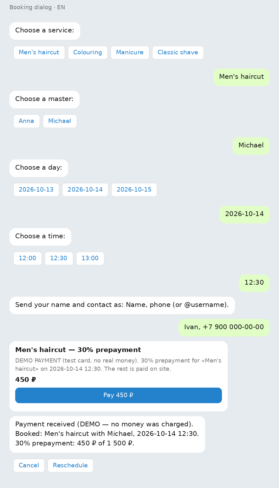
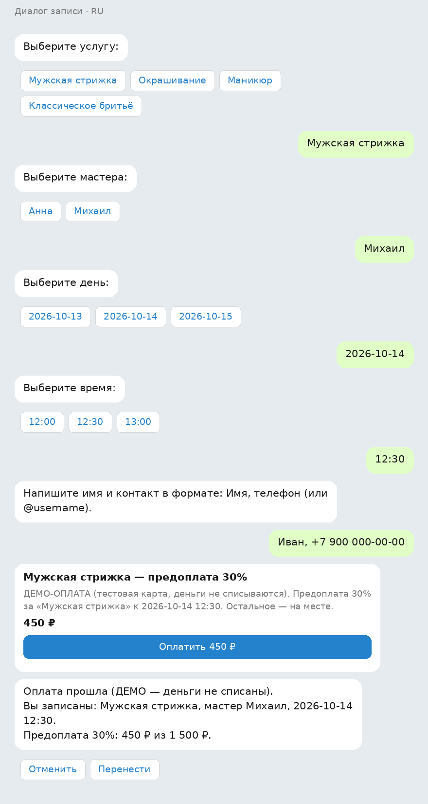

# Booking Bot with 30% Test-Mode Prepayment — Telegram Template

A ready-to-run Telegram booking bot: the client picks a service, a master, a day and a time,
leaves a name and contact, and pays a **30% prepayment** by invoice. Ships with a fictional
demo salon («Craft Podium Demo») so you can try the whole flow in minutes, then re-skin it
to your own business.

Сделано в Craft Podium — [craftpodium.com/free-review/bot/](https://craftpodium.com/free-review/bot/)



## What the bot does

- **Full booking flow** — service → master → day → time → name + contact → 30% prepayment invoice.
- **Slot holding** — the chosen slot is held while the invoice is open (15 minutes by default) and
  released automatically if the client does not pay.
- **No double booking and no time travel** — slots are taken by one conditional database update;
  past slots are never offered, and a stale button pressed later is refused with a clear message.
- **Honest payment handling** — the booking is confirmed only when the payment provider confirms it.
  If confirmation fails, the client is told plainly that a refund is due and every admin gets an alert
  (the refund itself is done manually in the provider's dashboard).
- **Reminders** — 24 hours and 2 hours before the visit, catch-up safe after a restart.
- **Cancel / reschedule** — from the booking message, up to `CANCEL_HOURS` before the start
  (12 hours by default); the freed slot becomes bookable again immediately.
- **Admin panel** — `/admin` with a day schedule, open/close a slot, manual booking, CSV export.
- **Two languages** — Russian and English, chosen automatically from the client's Telegram language
  (`/lang` switches it).
- **Simple to run** — sqlite (Python standard library), no external services. The demo salon data is
  seeded on first start.

## Quickstart — 5 minutes

1. **Create the bot** with [@BotFather](https://t.me/BotFather) (`/newbot`) and put the token in
   `TELEGRAM_BOT_TOKEN`. Set `BOT_USERNAME` to the bot's @username.
2. **Test payments**: in [@BotFather](https://t.me/BotFather) open your bot → *Payments* and connect
   a test payment provider. Put its token in `PAYMENT_PROVIDER_TOKEN` and its sandbox card number in
   `TEST_CARD_NUMBER` (the card number is never hardcoded — it comes from the environment).
3. **Configure**:
   ```bash
   cp .env.example .env   # then fill in the values
   ```
4. **Run**:
   ```bash
   python3 -m venv venv && . venv/bin/activate
   pip install -r requirements.txt
   python -m bookingbot
   ```
5. Open the bot in Telegram and book something. In `DEMO_FAST=1` mode the reminders and the cancel
   window are compressed to minutes, so you can see the whole life of a booking quickly.

All variables are listed in [.env.example](.env.example) (without values — your values stay in `.env`,
which is ignored by git).

## Change the salon to your own niche

Everything about the business lives in [`bookingbot/seed.py`](bookingbot/seed.py):

- `SERVICES` — `(slug, name_ru, name_en, duration_min, price_minor)`; `price_minor` is in minor units
  (kopecks for RUB, cents for USD/EUR).
- `MASTERS` — `(name_ru, name_en, service_slugs)` — who does what.

The demo figures are placeholders: replace them with your own services, people and prices. Stop the
bot, delete the database file (`DB_PATH`, default `data/bookings.sqlite3`), and start again — the data
is seeded once, when the services table is empty. The working hours are `10:00–20:00` with a 30-minute
grid (`bookingbot/config.py`: `work_start_hour`, `work_end_hour`, `slot_minutes`); the time zone is
`TZ_NAME` (default `Europe/Moscow`).

## Enable real payments

Only two things change — no code edits:

1. `PAYMENT_PROVIDER_TOKEN` — the token of your real provider (ЮKassa, Stripe, Smart Glocal, …), taken
   from the provider's dashboard and connected in @BotFather → *Payments*.
2. `CURRENCY` — the provider's currency (`RUB`, `USD`, `EUR`; default `RUB`).

The prepayment share is 30% of the service price from `seed.py` (`price_minor * 30 // 100`). Refunds
are manual: the bot records the charge and alerts `ADMIN_IDS`, you return the money in the provider's
dashboard.

## Limits — honest ones

- The demo salon is fictional and every price in `seed.py` is a demo figure.
- One service per booking (pick another service for another visit).
- Refunds are manual — the bot records and alerts, it does not call the provider's refund API.
- Telegram only: no web forms, no backend besides the bot and its sqlite file.

## Environment variables

| Variable | Required | Default | Meaning |
| --- | --- | --- | --- |
| `TELEGRAM_BOT_TOKEN` | yes | — | bot token from @BotFather |
| `PAYMENT_PROVIDER_TOKEN` | yes | — | payment provider token (test or live) |
| `TEST_CARD_NUMBER` | yes | — | sandbox card number shown in the demo disclaimer |
| `BOT_USERNAME` | no | — | bot @username (for share links) |
| `CURRENCY` | no | `RUB` | invoice currency |
| `ADMIN_IDS` | no | — | comma-separated Telegram user ids for admin commands and alerts |
| `DB_PATH` | no | `data/bookings.sqlite3` | sqlite database file |
| `DEMO_FAST` | no | off | `1` — compress reminders and the cancel window to minutes |
| `CANCEL_HOURS` | no | `12` | hours before the start when cancelling is still allowed |
| `HOLD_MINUTES` | no | `15` | how long the slot is held while the invoice is open |
| `SEED_DAYS` | no | `14` | how many days ahead the slot grid is created |
| `TZ_NAME` | no | `Europe/Moscow` | salon time zone |

## Commands

`/start` `/help` — start and help · `/book` — book · `/lang` — switch language · `/cancel` — cancel a
booking. Admin: `/admin` — panel with the day schedule, manual booking (`/manual`), close/open a slot
(`/close`, `/open`), CSV export (`/export`).

## License

MIT — see [LICENSE](LICENSE). Copyright (c) Craft Podium.

---

# На русском

Готовый Telegram-бот записи с **предоплатой 30%**: клиент выбирает услугу, мастера, день и время,
оставляет имя и контакт, платит предоплату по счёту. Внутри — вымышленный демо-салон «Craft Podium
Demo», чтобы попробовать весь путь за минуты, а затем заменить его на свой бизнес.



**Что умеет бот**

- Полный путь записи: услуга → мастер → день → время → имя и контакт → счёт на предоплату 30%.
- Слот удерживается, пока открыт счёт (15 минут по умолчанию), и освобождается автоматически, если
  клиент не оплатил.
- Без двойных броней и без записи в прошлое: слот занимается одной условной записью в базу; прошедшие
  слоты не предлагаются, а устаревшая кнопка отвечает «Это время уже прошло».
- Честная оплата: запись подтверждается только когда подтверждает платёжный провайдер; если
  подтверждения нет — клиенту прямо сообщают, что нужен возврат, и все администраторы получают
  уведомление (сам возврат — вручную в кабинете провайдера).
- Напоминания за 24 часа и за 2 часа до визита, с догоном после перезапуска.
- Отмена и перенос из сообщения с записью — не позднее `CANCEL_HOURS` до начала (12 часов по
  умолчанию), освободившееся время сразу доступно другим.
- Админ-панель `/admin`: расписание дня, закрыть/открыть слот, ручная запись, выгрузка CSV.
- Два языка: русский и английский автоматически по языку Telegram (`/lang` переключает).
- Простой запуск: sqlite из стандартной библиотеки, без внешних сервисов; данные демо-салона
  создаются при первом старте.

**Быстрый старт — 5 минут**

1. Создайте бота в [@BotFather](https://t.me/BotFather) (`/newbot`), токен — в `TELEGRAM_BOT_TOKEN`,
   `BOT_USERNAME` — @имя бота.
2. Тестовые платежи: в [@BotFather](https://t.me/BotFather) откройте бота → *Payments* и подключите
   тестовый платёжный провайдер; его токен — в `PAYMENT_PROVIDER_TOKEN`, номер тестовой карты — в
   `TEST_CARD_NUMBER` (номер карты нигде не зашит в код — только в окружении).
3. Настройка: `cp .env.example .env` и заполните значения.
4. Запуск: `python3 -m venv venv && . venv/bin/activate`, `pip install -r requirements.txt`,
   `python -m bookingbot`.
5. Откройте бота и запишитесь. С `DEMO_FAST=1` напоминания и окно отмены сжаты до минут — всю жизнь
  записи видно сразу.

**Своя ниша** — всё о бизнесе в [`bookingbot/seed.py`](bookingbot/seed.py): `SERVICES` (slug, название
ru/en, длительность в минутах, цена в минорных единицах — копейках/центах) и `MASTERS` (имена и какие
услуги оказывает). Демо-цифры — заглушки: замените на свои, остановите бота, удалите файл базы
(`DB_PATH`) и запустите снова. Часы работы 10:00–20:00, шаг сетки 30 минут, часовой пояс `TZ_NAME`.

**Настоящие платежи** — меняются только два значения: `PAYMENT_PROVIDER_TOKEN` (ЮKassa, Stripe, Smart
Glocal — из кабинета провайдера) и `CURRENCY` (`RUB`/`USD`/`EUR`). Код не трогаем. Доля предоплаты —
30% цены из `seed.py`; возвраты ручные.

**Ограничения честно**: салон вымышленный, цены в `seed.py` — демо; одна услуга на запись; возврат —
вручную (бот фиксирует и уведомляет, но не вызывает API возврата); только Telegram, без веб-форм.

**Лицензия** — MIT, автор Craft Podium, см. [LICENSE](LICENSE).
